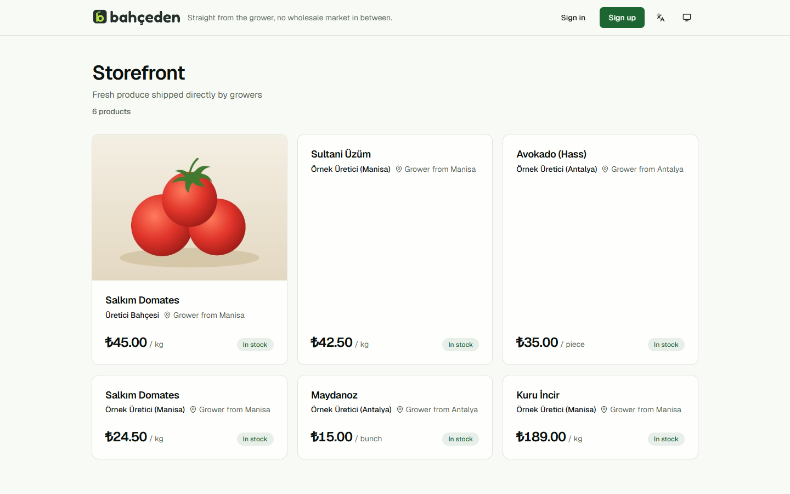
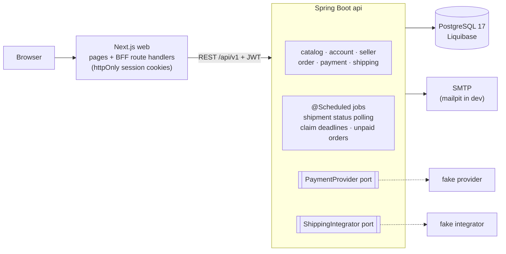
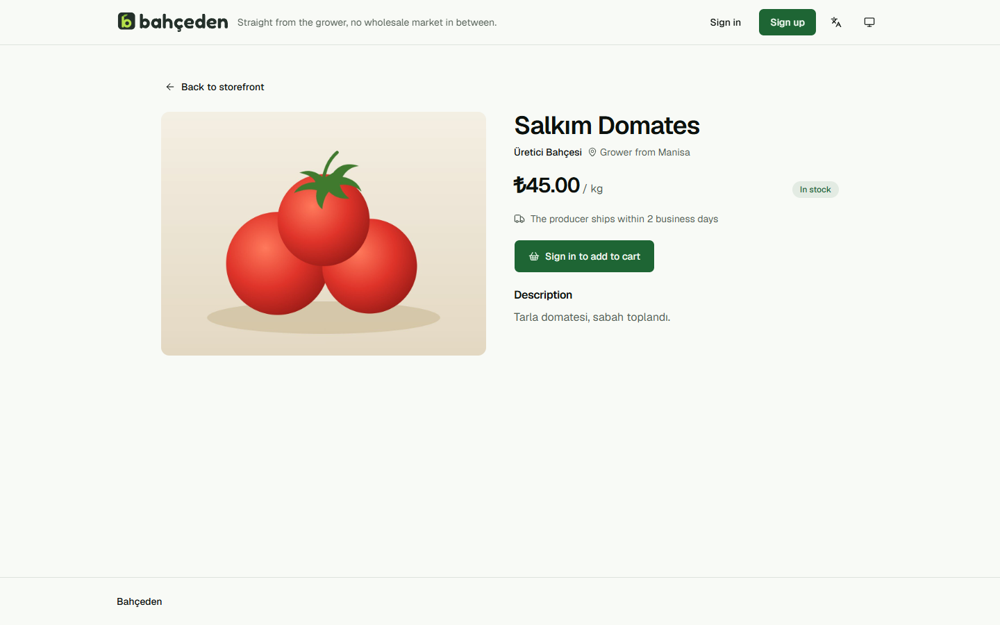
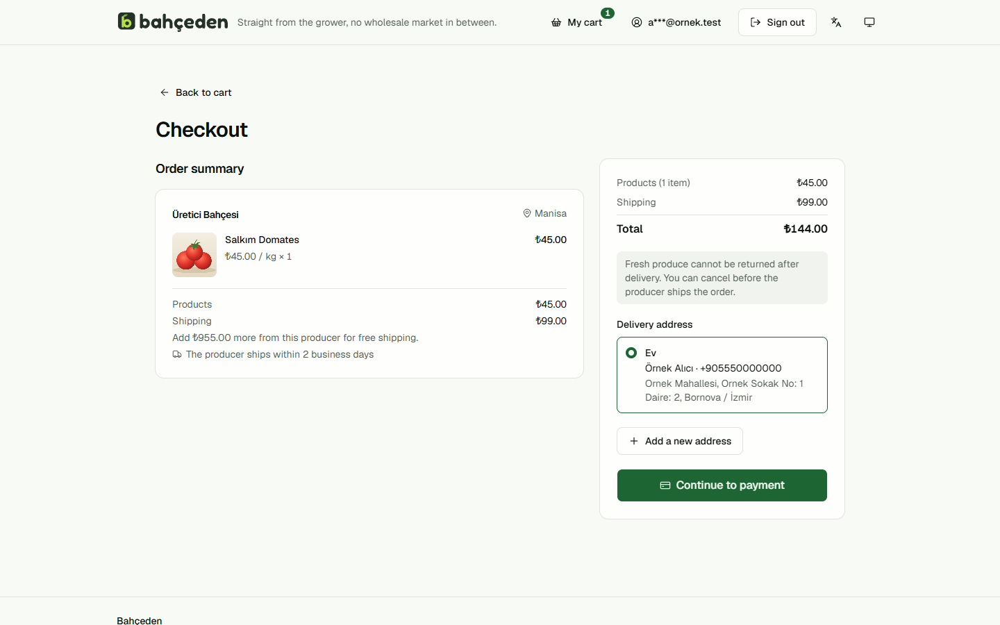
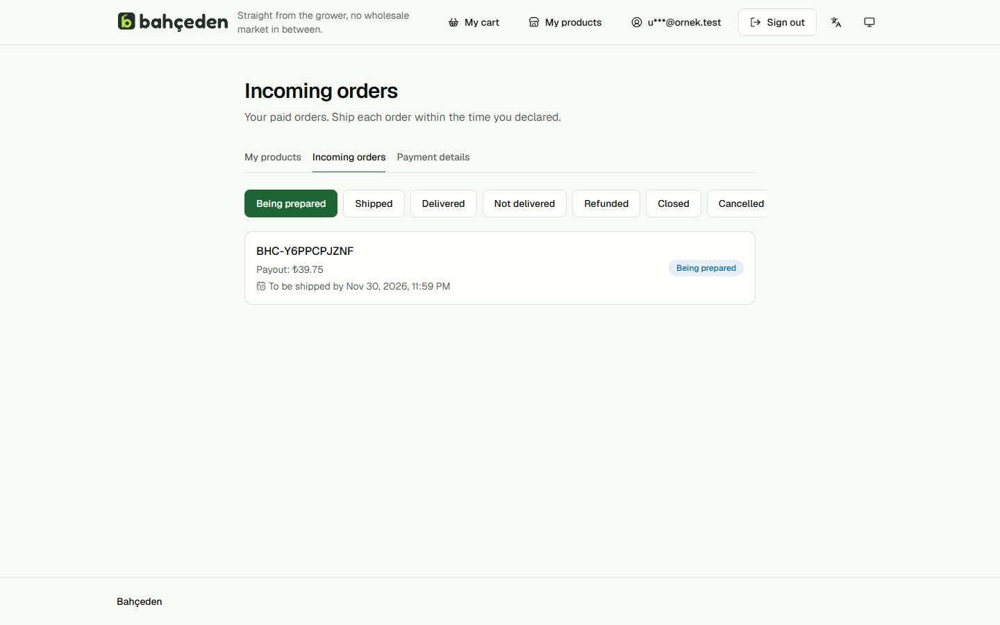

# Bahçeden

[](https://github.com/sertacozmen1/bahceden/actions/workflows/ci.yml)

**A multi-seller produce marketplace: growers list fruit and vegetables, buyers order from several growers in one checkout, and each grower ships their own parcel.**

**Stack:** Java 21 · Spring Boot 3.5 · Spring Security (JWT) · JPA · Liquibase · PostgreSQL 17 · Next.js 16 (App Router) · React 19 · TypeScript · Tailwind CSS 4 · shadcn/ui · next-intl · Testcontainers · Vitest · Docker Compose · GitHub Actions



## What works today

Seven vertical slices run end to end, from the database to the UI. Each one has its own feature record in [`docs/features/`](docs/features/index.md):

| Slice | What a user can do |
|---|---|
| **Storefront** | Browse published products with grower name and city; product detail page with a photo gallery. |
| **Accounts & sessions** | Register, verify email, sign in, silent session refresh, optional email-code two-step sign-in, password reset and change. |
| **Seller onboarding** | Apply as a seller with a document; an admin approves, rejects, suspends or reinstates. |
| **Listings** | Approved sellers create listings and upload 1–5 photos (EXIF-rotated, resized, location stripped). Admins can take listings down. |
| **Cart & checkout** | Server-side cart grouped by grower, address book, split payment through a payment-provider port, per-grower shipping fee and commission, cancellation with refund before shipment. |
| **Shipments** | Sellers create a shipment and open the PDF label. A scheduled job polls shipment status (shipped → in transit → delivered), and buyers get the tracking number and emails. |
| **Defect claims** | Within 48 h of delivery the buyer reports damaged items with photos. The seller accepts, offers a partial refund or rejects. Deadlines run on a scheduled sweep, and an admin decides escalated claims. |

The UI, API messages and emails are available in Turkish and English.

> [!NOTE]
> **Payment and shipping use fake adapters.** `PaymentProvider` and `ShippingIntegrator` are ports with only a `fake` implementation so far: the fake provider approves every payment and the fake integrator advances shipments on a timer. Choosing a real provider is an open business decision ([current state](docs/reference/00-current-state.md), L1).

## Architecture



- **One write authority.** Only `api` writes to the database. `web` reaches it server-side through BFF route handlers, so tokens never reach browser JavaScript ([ADR-001](docs/adr/001-spring-api-and-next-web.md), [ADR-023](docs/adr/023-web-bff-cookies-and-header-csrf.md)).
- **Contract generated from code.** `shared/contracts/openapi.yaml` is generated from the Spring DTOs (springdoc), and a test fails if the committed file is stale. `web` generates its TypeScript types from it ([ADR-009](docs/adr/009-contract-generated-from-spring.md), [ADR-015](docs/adr/015-contract-freshness-enforced-by-test.md)).
- **Money as integer minor units**, priced on the server ([ADR-006](docs/adr/006-money-as-minor-unit.md), [ADR-065](docs/adr/065-order-pricing-integer-minor-units-half-up.md)).
- **Seller data isolation at query level**, default deny ([ADR-007](docs/adr/007-query-level-ownership-scoping.md)).

## Quick start

Requires Docker with Compose v2.

```bash
git clone https://github.com/sertacozmen1/bahceden.git
cd bahceden
docker compose up -d --build --wait
```

| Service | URL |
|---|---|
| Web (storefront, seller and admin panels) | http://localhost:3000 |
| API health | http://localhost:8080/api/v1/health |
| OpenAPI document (runtime) | http://localhost:8080/v3/api-docs |
| Mailpit (captured emails) | http://localhost:8025 |

The `api` container starts with the `dev` profile and loads seed data. All dev accounts use the password `gelistirme-parolasi-1`, which exists only in the local database:

| Account | Role |
|---|---|
| `alici@ornek.test` | Buyer with a verified email and a saved address |
| `uretici@ornek.test` | Approved seller with a payout account |
| `admin@ornek.test` | Admin (`/admin/sellers`, `/admin/products`, `/admin/orders`, `/admin/claims`) |

`docker compose down -v` removes the database and uploaded files. The full walkthrough (in Turkish) is in [docs/how-to/yerel-gelistirme.md](docs/how-to/yerel-gelistirme.md) (section 7).

## Tests

```bash
# api: JUnit 5; integration tests run against real PostgreSQL via Testcontainers (Docker required)
cd api && ./mvnw -B verify

# web: Vitest + Testing Library
cd web && npm ci && npm run gen:api && npm test
```

CI ([`.github/workflows/ci.yml`](.github/workflows/ci.yml)) runs four jobs on every pull request: `api` (build and tests on Java 21), `web` (lint, type check, tests, build), `docs` (MkDocs strict build) and a rules check that blocks leftover `TODO`/debug output and secret-like files.

## Screenshots

Taken from the local `docker compose` stack with dev seed data. The product image is a demo illustration.

| Product detail | Checkout |
|---|---|
|  |  |

| Seller panel: incoming orders |
|---|
|  |

## Documentation

| | |
|---|---|
| [Architecture decision records](docs/adr/index.md) | Numbered ADRs: context, decision, consequences |
| [OpenAPI contract](shared/contracts/openapi.yaml) | Generated from the API, committed so contract changes show up in PR diffs |
| [Current state](docs/reference/00-current-state.md) | What runs today, known limitations, verified environment |
| [Feature records](docs/features/index.md) · [Domain model](docs/reference/01-domain-model.md) · [API reference](docs/reference/02-api-reference.md) | Behaviour, schema and endpoints |
| [AGENTS.md](AGENTS.md) | Working rules for humans and AI assistants: docs first, contract first, vertical slices |

The project documentation is written in Turkish; this overview is in English.

---

## Türkçe dokümantasyon

Bahçeden, meyve-sebze üreticisini son tüketiciyle **doğrudan** buluşturan çok satıcılı bir pazaryeridir. Manisa'daki bir üretici, bir hırdavatçının büyük pazaryerlerine kaydolduğu kolaylıkla kaydolur, ürününü listeler ve **kargo ile** gönderir. Hal, komisyoncu ve aradaki fiyat katmanları zincirden çıkar.

Bu monorepo iki dağıtılabilir birim barındırır: **`api/`** (Spring Boot 3 REST API, tek yazma otoritesi) ve **`web/`** (Next.js, alıcı vitrini + satıcı paneli). İkisi arasındaki tek sözleşme `shared/contracts/openapi.yaml` dosyasıdır ([ADR-001](docs/adr/001-spring-api-and-next-web.md), [ADR-003](docs/adr/003-openapi-as-single-contract.md)).

> [!IMPORTANT]
> Mevcut durum, tamamlanmış işler ve bilinen sınırlamalar için her zaman projenin gerçeği olan [docs/reference/00-current-state.md](docs/reference/00-current-state.md) dosyasını referans alın. Yol haritası ve ürün belgeleri bu soruya cevap olarak kullanılamaz.

### Nereden başlamalı?

| Sıra | Dosya | Ne verir |
|---|---|---|
| 1 | [docs/reference/00-current-state.md](docs/reference/00-current-state.md) | Şu an gerçekten ne var, ne yok |
| 2 | [AGENTS.md](AGENTS.md) | Monorepo anayasası: K1–K10 kuralları, akış, yasaklar. **İnsan ve AI için bağlayıcı.** |
| 3 | [docs/adr/index.md](docs/adr/index.md) | Teknoloji ve mimari kararlar, gerekçeleriyle |
| 4 | [docs/how-to/yerel-gelistirme.md](docs/how-to/yerel-gelistirme.md) | Makineyi çalışır hale getirme |
| 5 | [openspec/KALANLAR.md](openspec/KALANLAR.md) | Karar bekleyen ticari ve hukuki konular (gerçek ödeme ve kargo sağlayıcısı, saklama süreleri) |

### Depo yapısı

```text
bahceden/
├── AGENTS.md              ← Anayasa: tüm AI asistanları ve geliştiriciler için tek doğruluk kaynağı
├── api/                   ← Spring Boot 3 REST API (Java 21, Maven)
├── web/                   ← Next.js (App Router, TypeScript)
├── shared/contracts/      ← openapi.yaml: iki birim arasındaki tek sözleşme (api'den üretilir)
├── docker-compose.yml     ← db + api + web + mailpit
├── docs/                  ← Diátaxis dokümantasyon + adr/ + features/ + screenshots/
├── openspec/              ← Spec-driven change çalışma alanı + KALANLAR.md
├── .claude/               ← /opsx:* komutları ve openspec skill'leri
├── .githooks/pre-commit   ← Katmana göre doğrulama + K6/K10 taraması
└── .github/workflows/     ← CI: api testleri, web lint/build, docs strict, kural denetimi
```

### Hızlı başlangıç

```bash
git clone https://github.com/sertacozmen1/bahceden.git
cd bahceden
git config core.hooksPath .githooks     # commit öncesi doğrulama (klon başına bir kez)
docker compose up -d --build --wait     # db + api (8080) + web (3000) + mailpit (8025)
```

Araç kurulumu (JDK 21, Maven, Node, Docker), dev hesapları ve akışları elle deneme için: [Yerel geliştirme ortamını kurma](docs/how-to/yerel-gelistirme.md).

Dokümantasyon portalı:

```bash
./docs/.tools/serve.sh                  # http://localhost:8888
```

### Çalışma biçimi

- **Önce doküman.** Yeni özellik, davranış değişikliği veya mimari karar koddan değil dokümandan başlar (`AGENTS.md` K1). Spec'i değiştiren işler OpenSpec change ile planlanır; küçük işler bile [`docs/features/`](docs/features/index.md) *Tarihçe* satırı bırakır.
- **Önce sözleşme.** İstemciye görünen her değişiklik `shared/contracts/openapi.yaml` ile başlar; `web` tiplerini üretir, elle yazmaz (`AGENTS.md` K2, [ADR-003](docs/adr/003-openapi-as-single-contract.md)).
- **Dikey dilim.** İş, uçtan uca çalışan tek bir akış olarak kesilir: sözleşme → migration → entity → service → controller → üretilen tipler → ekran → test (`AGENTS.md` K5).
- **Bağımlılık bütçesi var.** Bütçe dışına paket eklemek onay ve ADR gerektirir ([ADR-002](docs/adr/002-dependency-budget.md)).
- **Secret bağlama girmez.** `.env`, gerçek müşteri verisi, ödeme ve kargo anahtarları ne commit'e ne AI bağlamına girer (`AGENTS.md` K10).

### Branch ve commit

- Branch: `<TICKET>-kisa-aciklama`, `hotfix/…` veya `docs/…`. `main`'e doğrudan commit yok.
- Commit mesajı İngilizce, emir kipi: `type(scope): summary` — `type` ∈ {feat, fix, docs, refactor, test, chore, ci}, `scope` ∈ {api, web, shared, docs, adr, infra}.

Ayrıntı: `AGENTS.md` §13.
