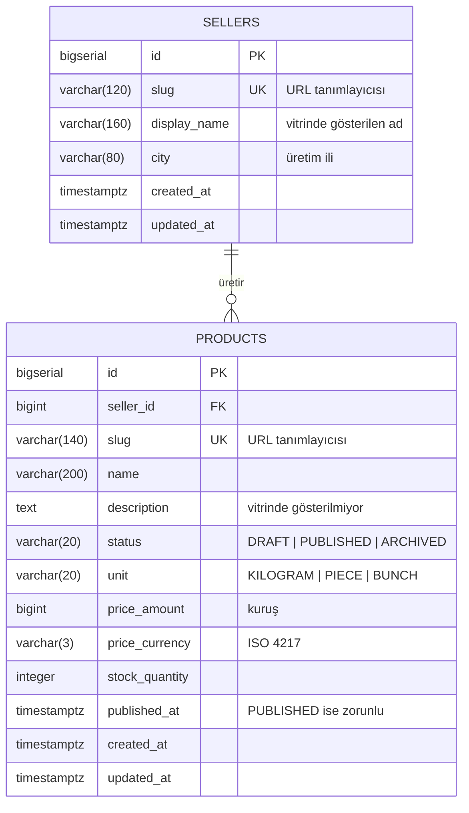

# Domain Modeli ve Veritabanı Şeması

**Son doğrulama:** 2026-10-06 · Kaynak: `api/src/main/resources/db/changelog/`

> Bu sayfa şemanın **mevcut halini** anlatır, hedefini değil. Şema yalnızca Liquibase ile değişir ([ADR-016](../adr/016-liquibase-for-schema-migrations.md)); changeset değiştiğinde bu sayfa aynı commit'te güncellenir (`AGENTS.md` K4).

---

## Mevcut durum

Şemada bugün yalnızca **katalog** vardır: üretici ve ürün. Hesap, sipariş, ödeme ve gönderim tabloları henüz yok ([güncel durum](00-current-state.md)).

---

## `sellers`

Ürünü üreten ve gönderen üretici.

| Kolon | Tip | Not |
|---|---|---|
| `id` | `bigserial` | Birincil anahtar |
| `slug` | `varchar(120)` | Tekil; URL'de kullanılır |
| `display_name` | `varchar(160)` | Vitrinde gösterilen ad |
| `city` | `varchar(80)` | Ürünün hangi yöreden geldiğini göstermek için |
| `created_at`, `updated_at` | `timestamptz` | UTC |

> [!IMPORTANT]
> Bu tablo **bilinçli olarak minimumdur** ([ADR-013](../adr/013-minimal-seller-table-ahead-of-onboarding.md)). Hesap ilişkisi, vergi/belge alanları, onay durumu ve iletişim bilgisi **yoktur**; satıcı onboarding kararı (`openspec/KALANLAR.md` A3) verildiğinde `V2` migration'ı ile gelecektir. Bugün üretici kaydı yalnızca geliştirme seed'i ile oluşur.

---

## `products`

Satılan ürün ilanı.

| Kolon | Tip | Not |
|---|---|---|
| `id` | `bigserial` | Birincil anahtar |
| `seller_id` | `bigint` | `sellers(id)` yabancı anahtarı |
| `slug` | `varchar(140)` | Tekil; URL'de kullanılır |
| `name` | `varchar(200)` | Ürün adı |
| `description` | `text` | Şemada var, **sözleşmede yok**: liste ucu göstermiyor, detay sayfası dilimiyle açılacak |
| `status` | `varchar(20)` | `DRAFT` / `PUBLISHED` / `ARCHIVED`; enum olarak modellendi ([ADR-010](../adr/010-product-status-as-enum.md)) |
| `unit` | `varchar(20)` | `KILOGRAM` / `PIECE` / `BUNCH` |
| `price_amount` | `bigint` | **Kuruş** cinsinden tamsayı ([ADR-006](../adr/006-money-as-minor-unit.md)) |
| `price_currency` | `varchar(3)` | ISO 4217. `char(3)` değil: `bpchar` Hibernate şema doğrulamasıyla uyumsuz |
| `stock_quantity` | `integer` | Negatif olamaz |
| `published_at` | `timestamptz` | `PUBLISHED` ise zorunlu (kısıt) |
| `created_at`, `updated_at` | `timestamptz` | UTC |

### Kısıtlar

| Kısıt | Ne garanti eder |
|---|---|
| `products_status_check` | Durum yalnızca üç değerden biri olabilir |
| `products_unit_check` | Birim yalnızca üç değerden biri olabilir |
| `products_price_amount_check` | Fiyat negatif olamaz |
| `products_stock_check` | Stok negatif olamaz |
| `products_published_requires_date` | Yayınlanmış ürünün yayın tarihi olmak zorunda: vitrin sıralaması buna dayanıyor ve geçersiz durum veritabanında temsil edilemez |

### İndeksler

| İndeks | Hangi sorgu için |
|---|---|
| `products_storefront_idx` — `(published_at desc, id desc) where status = 'PUBLISHED'` | Vitrin listesinin tam deseni: süzgeç + sıralama. Kısmi indeks, yayınlanmamış ilanları taşımaz |
| `products_seller_idx` — `(seller_id)` | Üreticiye göre sorgular (satıcı paneli dilimi) |
| `sellers_slug_unique`, `products_slug_unique` | URL tanımlayıcılarının tekilliği |

---

## Entity ↔ tablo eşlemesi

| Java tipi | Tablo | Not |
|---|---|---|
| `com.bahceden.catalog.domain.Seller` | `sellers` | Yalnızca okuma; bu dilimde yazma akışı yok |
| `com.bahceden.catalog.domain.Product` | `products` | `seller` ilişkisi `LAZY`; liste sorgusu `join fetch` ile çeker ([ADR-011](../adr/011-fetch-join-with-query-count-test.md)) |
| `com.bahceden.common.money.Money` | `products.price_amount`, `products.price_currency` | `@Embeddable`; ayrı tablo yok |

`spring.jpa.hibernate.ddl-auto` her ortamda `validate`: entity ile şema uyuşmazsa uygulama **ayağa kalkmaz**. Bu koruma, geliştirme sırasında `char(3)` / `varchar(3)` uyumsuzluğunu gerçekten yakaladı.
