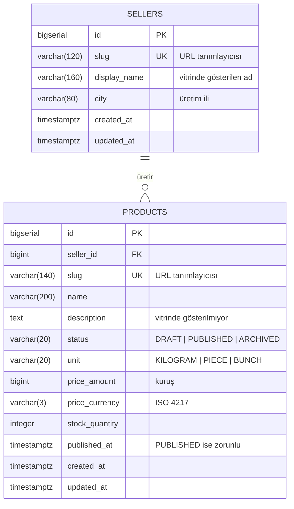
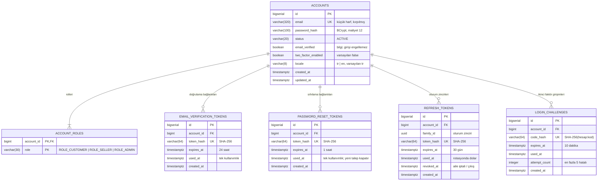

# Domain Modeli ve Veritabanı Şeması

**Son doğrulama:** 2026-10-07 · Kaynak: `api/src/main/resources/db/changelog/`

> Bu sayfa şemanın **mevcut halini** anlatır, hedefini değil. Şema yalnızca Liquibase ile değişir ([ADR-016](../adr/016-liquibase-for-schema-migrations.md)); changeset değiştiğinde bu sayfa aynı commit'te güncellenir (`AGENTS.md` K4).

---

## Mevcut durum

Şemada bugün iki bölge vardır: **katalog** (üretici ve ürün) ve **hesap** (hesap, roller, tek kullanımlık token'lar, oturum zinciri, ikinci faktör girişimleri). Sipariş, ödeme ve gönderim tabloları henüz yok ([güncel durum](00-current-state.md)).

İki bölge arasında **bilinçli olarak ilişki yoktur**: `products.seller_id` → `sellers`, `accounts` ile bağlı değildir. Satıcı ile hesabın nasıl bağlanacağı satıcı onboarding kararına (`openspec/KALANLAR.md` A3, [ADR-013](../adr/013-minimal-seller-table-ahead-of-onboarding.md)) bağlıdır; karar verilmeden bir yabancı anahtar kurmak o kararı önceden almak olurdu.

---

## `sellers`

Ürünü üreten ve gönderen üretici.

| Kolon | Tip | Not |
|---|---|---|
| `id` | `bigserial` | Birincil anahtar |
| `slug` | `varchar(120)` | Tekil; URL'de kullanılır |
| `display_name` | `varchar(160)` | Vitrinde gösterilen ad |
| `city` | `varchar(80)` | Ürünün hangi yöreden geldiğini göstermek için |
| `created_at`, `updated_at` | `timestamptz` | UTC |

> [!IMPORTANT]
> Bu tablo **bilinçli olarak minimumdur** ([ADR-013](../adr/013-minimal-seller-table-ahead-of-onboarding.md)). Hesap ilişkisi, vergi/belge alanları, onay durumu ve iletişim bilgisi **yoktur**; satıcı onboarding kararı (`openspec/KALANLAR.md` A3) verildiğinde `V2` migration'ı ile gelecektir. Bugün üretici kaydı yalnızca geliştirme seed'i ile oluşur.

---

## `products`

Satılan ürün ilanı.

| Kolon | Tip | Not |
|---|---|---|
| `id` | `bigserial` | Birincil anahtar |
| `seller_id` | `bigint` | `sellers(id)` yabancı anahtarı |
| `slug` | `varchar(140)` | Tekil; URL'de kullanılır |
| `name` | `varchar(200)` | Ürün adı |
| `description` | `text` | Şemada var, **sözleşmede yok**: liste ucu göstermiyor, detay sayfası dilimiyle açılacak |
| `status` | `varchar(20)` | `DRAFT` / `PUBLISHED` / `ARCHIVED`; enum olarak modellendi ([ADR-010](../adr/010-product-status-as-enum.md)) |
| `unit` | `varchar(20)` | `KILOGRAM` / `PIECE` / `BUNCH` |
| `price_amount` | `bigint` | **Kuruş** cinsinden tamsayı ([ADR-006](../adr/006-money-as-minor-unit.md)) |
| `price_currency` | `varchar(3)` | ISO 4217. `char(3)` değil: `bpchar` Hibernate şema doğrulamasıyla uyumsuz |
| `stock_quantity` | `integer` | Negatif olamaz |
| `published_at` | `timestamptz` | `PUBLISHED` ise zorunlu (kısıt) |
| `created_at`, `updated_at` | `timestamptz` | UTC |

### Kısıtlar

| Kısıt | Ne garanti eder |
|---|---|
| `products_status_check` | Durum yalnızca üç değerden biri olabilir |
| `products_unit_check` | Birim yalnızca üç değerden biri olabilir |
| `products_price_amount_check` | Fiyat negatif olamaz |
| `products_stock_check` | Stok negatif olamaz |
| `products_published_requires_date` | Yayınlanmış ürünün yayın tarihi olmak zorunda: vitrin sıralaması buna dayanıyor ve geçersiz durum veritabanında temsil edilemez |

### İndeksler

| İndeks | Hangi sorgu için |
|---|---|
| `products_storefront_idx` — `(published_at desc, id desc) where status = 'PUBLISHED'` | Vitrin listesinin tam deseni: süzgeç + sıralama. Kısmi indeks, yayınlanmamış ilanları taşımaz |
| `products_seller_idx` — `(seller_id)` | Üreticiye göre sorgular (satıcı paneli dilimi) |
| `sellers_slug_unique`, `products_slug_unique` | URL tanımlayıcılarının tekilliği |

---

## Hesap bölgesi

Changeset: `003-create-account.sql`, `005-account-locale.sql` (`locale` kolonu), `006-create-password-reset-tokens.sql`. Geliştirme hesapları: `004-dev-seed-account.sql` (yalnızca dev bağlamı).

### `accounts`

Tek hesap tablosu; aynı kişi hem alıcı hem satıcı olabilir ([ADR-008](../adr/008-jwt-auth-with-opaque-refresh.md)).

| Kolon | Tip | Not |
|---|---|---|
| `email` | `varchar(320)` | Tekil. Kayıt ve giriş aramadan önce küçük harfe çevirip kırpar (`Account.normalizeEmail`); tekil kısıt bu sayede gerçekten tekilliği garanti eder |
| `password_hash` | `varchar(100)` | BCrypt, maliyet 12. Düz parola hiçbir yerde saklanmaz ve loglanmaz |
| `status` | `varchar(20)` | Bugün tek değer `ACTIVE` ([ADR-017](../adr/017-email-verification-non-blocking-and-2fa-switch.md)); enum olarak tutulur ki askıya alma şema göçü gerektirmesin |
| `email_verified` | `boolean` | Doğrulama bağlantısı kullanıldı mı. **Girişi engellemez** |
| `two_factor_enabled` | `boolean` | E-posta ile ikinci faktör. Varsayılan `false`; ürün yüzeyinden değiştirilemez ([ADR-025](../adr/025-second-factor-code-bound-to-account.md)) |
| `locale` | `varchar(8)` | Hesabın dili (`tr`, `en`; `CHECK`). Kayıtta isteğin dili yazılır, her başarılı girişte güncellenir; hesaba giden e-postalar bu dilde ([ADR-032](../adr/032-account-locale-stored-and-refreshed-on-login.md)). Changeset `005-account-locale.sql` |

### `account_roles`

Hesabın rolleri, değer kümesi olarak (`@ElementCollection`). Birincil anahtar `(account_id, role)`. Kayıt olan herkes `ROLE_CUSTOMER` alır; `ROLE_SELLER` atama akışı yok (A3), `ROLE_ADMIN` yalnızca veritabanından verilir.

### `email_verification_tokens`

Doğrulama bağlantısının token'ı: yalnızca SHA-256 hash'i saklanır, 24 saat geçerlidir, tek kullanımlıktır ([ADR-020](../adr/020-verification-tokens-sha256-single-use.md)). Yeni bağlantı istendiğinde ([ADR-026](../adr/026-verification-link-resend-requires-session.md)) eski satırlar süreleri dolana kadar geçerli kalır.

### `password_reset_tokens`

Parola sıfırlama bağlantısının token'ı ([ADR-033](../adr/033-password-reset-token-separate-table-one-hour.md)): yalnızca SHA-256 hash'i saklanır, 1 saat geçerlidir, tek kullanımlıktır. Şekli `email_verification_tokens` ile aynıdır ama tablo ayrıdır: bir doğrulama token'ı parola değiştiremez. Yeni talep hesabın kullanılmamış satırlarına `used_at` yazar (`password_reset_tokens_account_idx`); onay satırı `SELECT … FOR UPDATE` ile kilitleyerek okur. Başarılı sıfırlama hesabın bütün `refresh_tokens` satırlarına `revoked_at`, açık `login_challenges` satırlarına `used_at` yazar ([ADR-035](../adr/035-password-reset-signs-out-everywhere-no-auto-login.md)).

### `refresh_tokens`

Opak yenileme token'ı ([ADR-018](../adr/018-refresh-token-rotation-with-family-revocation.md)). Her giriş yeni bir `family_id` başlatır; rotasyon aynı ailede kalır. Kullanılmış bir token tekrar sunulursa ailenin tüm satırlarına `revoked_at` yazılır. Yenileme ve çıkış satırı `SELECT … FOR UPDATE` ile kilitleyerek okur.

| İndeks | Hangi sorgu için |
|---|---|
| `refresh_tokens_hash_unique` | Hash ile arama |
| `refresh_tokens_family_idx` | Aile iptali: tek `update` sorgusu |
| `refresh_tokens_expires_idx` | İleride süresi dolmuş satırların temizliği |

### `login_challenges`

İkinci faktör girişimi ([ADR-025](../adr/025-second-factor-code-bound-to-account.md)). Kod hesaba bağlı hash'lenir: `SHA-256(account_id + ":" + kod)`. İkinci adım hesabın en son açılan, süresi geçmemiş ve kullanılmamış girişimini kilitleyerek okur. `attempt_count` 5'e ulaşınca girişim kilitlenir.

### Silme davranışı

Hesaba bağlı tüm tablolarda yabancı anahtar `on delete cascade`'dir: hesap silinirse roller, token'lar ve girişimler de gider. Hesap silme akışı bugün yoktur.

---

## Entity ↔ tablo eşlemesi

| Java tipi | Tablo | Not |
|---|---|---|
| `com.bahceden.catalog.domain.Seller` | `sellers` | Yalnızca okuma; bu dilimde yazma akışı yok |
| `com.bahceden.catalog.domain.Product` | `products` | `seller` ilişkisi `LAZY`; liste sorgusu `join fetch` ile çeker ([ADR-011](../adr/011-fetch-join-with-query-count-test.md)) |
| `com.bahceden.common.money.Money` | `products.price_amount`, `products.price_currency` | `@Embeddable`; ayrı tablo yok |
| `com.bahceden.account.domain.Account` | `accounts` + `account_roles` | Roller `@ElementCollection` (`EAGER`): yetkilendirme her zaman rollere ihtiyaç duyar |
| `com.bahceden.account.domain.EmailVerificationToken` | `email_verification_tokens` | |
| `com.bahceden.account.domain.PasswordResetToken` | `password_reset_tokens` | |
| `com.bahceden.account.domain.RefreshToken` | `refresh_tokens` | |
| `com.bahceden.account.domain.LoginChallenge` | `login_challenges` | |

`spring.jpa.hibernate.ddl-auto` her ortamda `validate`: entity ile şema uyuşmazsa uygulama **ayağa kalkmaz**. Bu koruma, geliştirme sırasında `char(3)` / `varchar(3)` uyumsuzluğunu gerçekten yakaladı.
