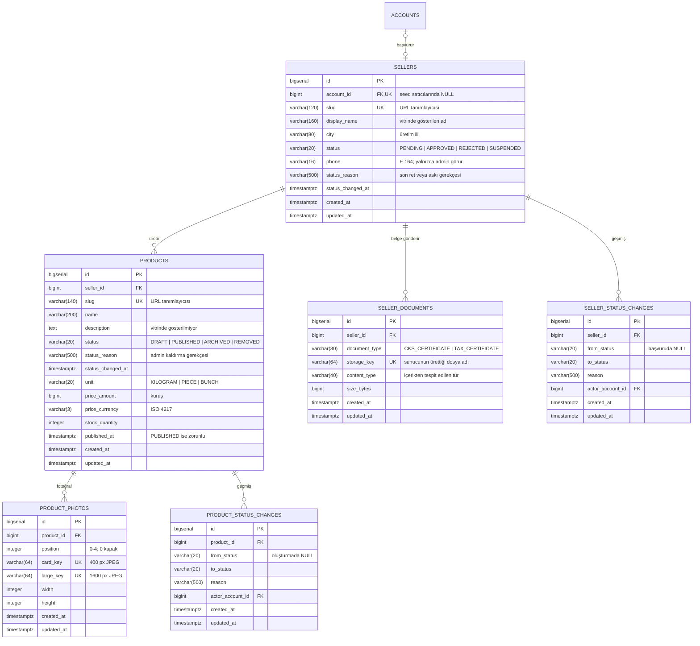
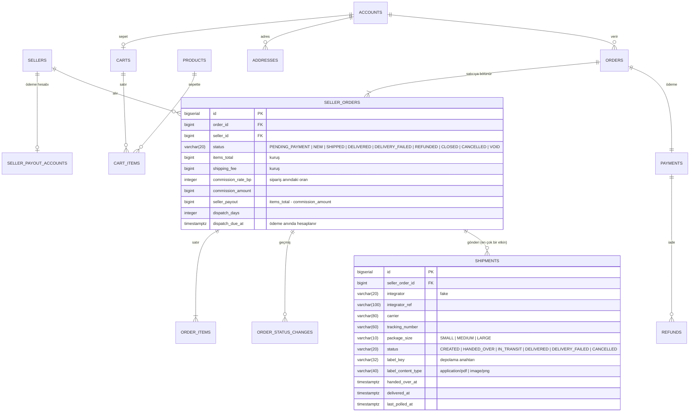

# Domain Modeli ve Veritabanı Şeması

**Son doğrulama:** 2026-10-10 (kargo gönderisi) · Kaynak: `api/src/main/resources/db/changelog/`

> Bu sayfa şemanın **mevcut halini** anlatır, hedefini değil. Şema yalnızca Liquibase ile değişir ([ADR-016](../adr/016-liquibase-for-schema-migrations.md)); changeset değiştiğinde bu sayfa aynı commit'te güncellenir (`AGENTS.md` K4).

---

## Mevcut durum

Şemada bugün dört bölge vardır:

- **katalog:** ürün;
- **satıcı:** üretici kaydı, başvuru belgeleri, durum geçmişi;
- **sipariş ve ödeme:** satıcının ödeme hesabı, sepet, adresler, sipariş, satıcı siparişi, satırlar, geçmiş, ödeme, iade ve kargo gönderisi (aşağıda);
- **hesap:** hesap, roller, tek kullanımlık token'lar, oturum zinciri, ikinci faktör girişimleri.

Satıcı ile hesap `sellers.account_id` üzerinden bağlıdır ([ADR-037](../adr/037-seller-application-with-document-and-manual-approval.md), [ADR-040](../adr/040-seller-application-is-the-seller-record.md)). Bu kolon NULL olabilir, çünkü dev seed'inden gelen satıcıların hesabı yok. Tekil kısıt, bir hesabın en fazla bir satıcı kaydı olmasını sağlar.

---

## `sellers`

Ürünü üreten ve gönderen üretici. Satıcı başvurusu bu satırın kendisidir: kayıt `PENDING` açılır ([ADR-040](../adr/040-seller-application-is-the-seller-record.md)). `001` changeset'i tabloyu minimum açtı ([ADR-013](../adr/013-minimal-seller-table-ahead-of-onboarding.md)); `007` changeset'i genişletti.

| Kolon | Tip | Not |
|---|---|---|
| `id` | `bigserial` | Birincil anahtar |
| `account_id` | `bigint` | `accounts(id)` yabancı anahtarı; tekil; seed satıcılarında NULL |
| `slug` | `varchar(120)` | Tekil; URL'de kullanılır; başvuruda üretici adından üretilir ve değişmez |
| `display_name` | `varchar(160)` | Vitrinde gösterilen ad |
| `city` | `varchar(80)` | Ürünün hangi yöreden geldiğini göstermek için |
| `status` | `varchar(20)` | `PENDING`, `APPROVED`, `REJECTED`, `SUSPENDED`; **varsayılanı yok** ([ADR-041](../adr/041-storefront-filters-seller-status-in-query.md)) |
| `phone` | `varchar(16)` | E.164 (`+90…`); kişisel veri, yalnızca admin ve sahibi görür (K10) |
| `status_reason` | `varchar(500)` | Son ret veya askı gerekçesi; satıcıya gösterilir |
| `status_changed_at` | `timestamptz` | Durumun son değiştiği an |
| `created_at`, `updated_at` | `timestamptz` | UTC |

Vitrin yalnızca `status = 'APPROVED'` satıcının ürünlerini gösterir ([ADR-038](../adr/038-listings-publish-immediately-with-admin-takedown.md), [ADR-041](../adr/041-storefront-filters-seller-status-in-query.md)). Admin listesi `sellers_status_idx (status, created_at desc, id desc)` indeksini kullanır.

## `seller_documents`

Başvuru belgelerinin meta verisi ([ADR-045](../adr/045-seller-documents-table-content-sniffing-protected-serving.md)). Dosyanın kendisi veritabanında değil, `BAHCEDEN_STORAGE_DIR` dizinindedir ([ADR-039](../adr/039-uploads-on-local-volume-served-by-api.md)). Her başvuru ve yeniden gönderim yeni bir satır yazar; güncel belge en son satırdır. Önceki belgeler silinmez. Kullanıcının verdiği dosya adı hiçbir yerde tutulmaz.

## `seller_status_changes`

Satıcı kaydının durum geçişleri: kim, ne zaman, hangi durumdan hangisine, neden ([ADR-037](../adr/037-seller-application-with-document-and-manual-approval.md) §7). **Yalnızca eklenir.** Uygulama kodunda güncelleme ve silme yolu yoktur. `actor_account_id`, başvuruda ve yeniden gönderimde başvuran hesaptır; kararlarda admin hesabıdır.

---

## `products`

Satılan ürün ilanı.

| Kolon | Tip | Not |
|---|---|---|
| `id` | `bigserial` | Birincil anahtar |
| `seller_id` | `bigint` | `sellers(id)` yabancı anahtarı |
| `slug` | `varchar(140)` | Tekil; URL'de kullanılır |
| `name` | `varchar(200)` | Ürün adı |
| `description` | `text` | Ürün detayında gösterilir (`GET /products/{slug}`); listede yok |
| `status` | `varchar(20)` | `DRAFT` / `PUBLISHED` / `ARCHIVED` / `REMOVED`; enum ([ADR-010](../adr/010-product-status-as-enum.md)); geçişler `ProductTransition`'da ([ADR-047](../adr/047-listing-states-removed-and-named-transitions.md)) |
| `unit` | `varchar(20)` | `KILOGRAM` / `PIECE` / `BUNCH` |
| `price_amount` | `bigint` | **Kuruş** cinsinden tamsayı ([ADR-006](../adr/006-money-as-minor-unit.md)) |
| `price_currency` | `varchar(3)` | ISO 4217. `char(3)` değil: `bpchar` Hibernate şema doğrulamasıyla uyumsuz |
| `stock_quantity` | `integer` | Negatif olamaz; ödeme başarılı olunca kilitle düşer, iptalde geri eklenir ([ADR-066](../adr/066-payment-redirect-verify-lock-stock-on-success.md), [ADR-067](../adr/067-cancel-before-shipment-full-refund-restock.md)) |
| `dispatch_days` | `integer` | Kargoya verme süresi, 1–3 iş günü; varsayılan 2 ([ADR-061](../adr/061-listing-dispatch-days-business-days-weekends-only.md)) |
| `published_at` | `timestamptz` | `PUBLISHED` ise zorunlu (kısıt). İlk yayında yazılır, yeniden yayında değişmez |
| `status_reason` | `varchar(500)` | Admin kaldırma gerekçesi; satıcıya gösterilir (ADR-038 §3) |
| `status_changed_at` | `timestamptz` | Durumun son değiştiği an |
| `created_at`, `updated_at` | `timestamptz` | UTC |

### Kısıtlar

| Kısıt | Ne garanti eder |
|---|---|
| `products_status_check` | Durum dört değerden biri; `009` changeset'i `REMOVED`'ı ekledi |
| `products_unit_check` | Birim yalnızca üç değerden biri olabilir |
| `products_price_amount_check` | Fiyat negatif olamaz |
| `products_stock_check` | Stok negatif olamaz |
| `products_dispatch_days_check` | Kargoya verme süresi 1–3; `011` changeset'i ekledi |
| `products_published_requires_date` | Yayınlanmış ürünün yayın tarihi olmak zorunda: vitrin sıralaması buna dayanıyor ve geçersiz durum veritabanında temsil edilemez |

### İndeksler

| İndeks | Hangi sorgu için |
|---|---|
| `products_storefront_idx` — `(published_at desc, id desc) where status = 'PUBLISHED'` | Vitrin listesinin tam deseni: süzgeç + sıralama. Kısmi indeks, yayınlanmamış ilanları taşımaz |
| `products_seller_idx` — `(seller_id)` | Üreticiye göre sorgular (satıcı paneli dilimi) |
| `sellers_slug_unique`, `products_slug_unique` | URL tanımlayıcılarının tekilliği |

---

## `product_photos`

İlan fotoğrafları ([ADR-049](../adr/049-listing-photos-table-one-by-one-position.md)). Kapak `position = 0` olan satırdır. `(product_id, position)` tekildir ve kısıt transaction sonunda denetlenir; sıralama tek transaction'da yer değiştirebilir. Dosyalar `BAHCEDEN_STORAGE_DIR` dizinindedir. Her fotoğraf için iki JPEG (400 px kart, 1600 px büyük) saklanır, orijinal saklanmaz ([ADR-050](../adr/050-photo-processing-exif-orientation-two-sizes.md)). `width` ve `height` büyük boyutun ölçüleridir. Anahtarlar herkese açık fotoğraf ucunun tek kaynağıdır: bu tabloda kayıtlı olmayan anahtar sunulmaz ([ADR-051](../adr/051-photo-serving-public-key-registered-web-proxy.md)).

## `product_status_changes`

İlanın durum geçişleri, yalnızca eklenir ([ADR-047](../adr/047-listing-states-removed-and-named-transitions.md)). `actor_account_id` satıcı geçişlerinde satıcının hesabı, kaldırma ve yeniden açmada admin'in hesabıdır.

## Sipariş ve ödeme bölgesi

`011-cart-and-checkout.sql` ile eklendi ([ADR-059](../adr/059-payment-and-order-packages-single-purchasability-rule.md)…[ADR-067](../adr/067-cancel-before-shipment-full-refund-restock.md)). Tutarlar kuruş cinsinden `bigint`'tir; siparişin para birimi `orders.currency` kolonundadır. Sipariş, ödeme ve iade kayıtları silinmez (§11.4).

| Tablo | İçerik | Not |
|---|---|---|
| `seller_payout_accounts` | Satıcı başına bir satır: tür, yasal ad, TCKN/VKN, vergi dairesi, IBAN, `ACTIVE` / `PROVIDER_REJECTED`, sağlayıcının alt üye anahtarı | IBAN ve kimlik numarası yanıtta maskeli, log'a yazılmaz; düz metin saklanır ([ADR-060](../adr/060-seller-payout-account-validated-masked-sync-submerchant.md)) |
| `carts`, `cart_items` | Hesabın tek sepeti; satır ürün ve adet (1–99), `(cart_id, product_id)` tekil | Fiyat tutulmaz ([ADR-062](../adr/062-server-side-cart-prices-read-live.md)) |
| `addresses` | Hesabın teslimat adresleri: başlık, alıcı, telefon (E.164), il plaka kodu, ilçe, açık adres, posta kodu | En çok 10; il teslimat listesinde olmalı ([ADR-063](../adr/063-delivery-provinces-config-address-book.md)) |
| `orders` | İş anahtarı `order_number`, alıcı, durum (`PENDING_PAYMENT`, `PAID`, `PAYMENT_FAILED`, `PAYMENT_EXPIRED`, `CANCELLED_OUT_OF_STOCK`), adres kopyası (`ship_*`), toplamlar, `idempotency_key` (alıcıyla tekil), `payment_expires_at`, `paid_at` | `grand_total = items_total + shipping_total` kısıtı ([ADR-064](../adr/064-three-level-order-snapshot-idempotency-key.md)) |
| `seller_orders` | Siparişin bir satıcıya düşen kısmı: kargo, komisyon, hakediş, kargoya verme süresi ve son tarihi, iptal eden taraf ve gerekçe | `seller_payout = items_total - commission_amount` ve `commission_amount <= items_total` kısıtları |
| `order_items` | Sipariş anındaki ürün adı, adresi, birimi, birim fiyatı, adet, satır tutarı | `line_total = unit_price * quantity` kısıtı |
| `order_status_changes` | Satıcı siparişi durum geçişleri, yalnızca eklenir; `actor_account_id` boşsa geçişi sistem (gönderi durumu sorgusu) yaptı | Repository çıplak `Repository`; `013` ile `actor_account_id` boş geçilebilir ([ADR-072](../adr/072-shipments-table-and-seller-order-shipping-states.md)) |
| `payments` | Siparişin ödemesi: sağlayıcı, referans, yönlendirme adresi, `INITIATED` / `SUCCEEDED` / `FAILED`, tutar | Sipariş başına bir ödeme ([ADR-066](../adr/066-payment-redirect-verify-lock-stock-on-success.md)) |
| `refunds` | İadeler: neden (`OUT_OF_STOCK`, `PAYMENT_EXPIRED`, `CANCELLED`, `UNDELIVERED`), tutar, sağlayıcı referansı; `seller_order_id` boşsa ödemenin tamamı | Yalnızca eklenir ([ADR-067](../adr/067-cancel-before-shipment-full-refund-restock.md)) |

| `shipments` | Satıcı siparişinin kargo gönderisi: entegratör ve anahtarı, firma, takip numarası, koli boyutu, durum, etiketin depolama anahtarı ve türü, kargoya verilme ve teslim zamanları, son sorgu zamanı. `013-shipments.sql` | İptal edilen silinmez; satıcı siparişi başına tek etkin gönderi `unique (seller_order_id) where status <> 'CANCELLED'`; `DELIVERED` ise `delivered_at` dolu ([ADR-072](../adr/072-shipments-table-and-seller-order-shipping-states.md)) |

İndeksler: `shipments (status, last_polled_at)` (durum sorgusu sırası), `orders (buyer_account_id, created_at desc, id desc)`, `seller_orders (seller_id, created_at desc, id desc)`, `addresses (account_id, id)`, `order_items (seller_order_id, id)`, `order_status_changes (seller_order_id, created_at, id)`, `refunds (payment_id)`.

## Hesap bölgesi

Changeset: `003-create-account.sql`, `005-account-locale.sql` (`locale` kolonu), `006-create-password-reset-tokens.sql`. Geliştirme hesapları: `004-dev-seed-account.sql` (yalnızca dev bağlamı).

### `accounts`

Tek hesap tablosu; aynı kişi hem alıcı hem satıcı olabilir ([ADR-008](../adr/008-jwt-auth-with-opaque-refresh.md)).

| Kolon | Tip | Not |
|---|---|---|
| `email` | `varchar(320)` | Tekil. Kayıt ve giriş aramadan önce küçük harfe çevirip kırpar (`Account.normalizeEmail`); tekil kısıt bu sayede gerçekten tekilliği garanti eder |
| `password_hash` | `varchar(100)` | BCrypt, maliyet 12. Düz parola hiçbir yerde saklanmaz ve loglanmaz |
| `status` | `varchar(20)` | Bugün tek değer `ACTIVE` ([ADR-017](../adr/017-email-verification-non-blocking-and-2fa-switch.md)); enum olarak tutulur ki askıya alma şema göçü gerektirmesin |
| `email_verified` | `boolean` | Doğrulama bağlantısı kullanıldı mı. **Girişi engellemez** |
| `two_factor_enabled` | `boolean` | E-posta ile ikinci faktör. Varsayılan `false`; ürün yüzeyinden değiştirilemez ([ADR-025](../adr/025-second-factor-code-bound-to-account.md)) |
| `locale` | `varchar(8)` | Hesabın dili (`tr`, `en`; `CHECK`). Kayıtta isteğin dili yazılır, her başarılı girişte güncellenir; hesaba giden e-postalar bu dilde ([ADR-032](../adr/032-account-locale-stored-and-refreshed-on-login.md)). Changeset `005-account-locale.sql` |

### `account_roles`

Hesabın rolleri, değer kümesi olarak (`@ElementCollection`). Birincil anahtar `(account_id, role)`. Kayıt olan herkes `ROLE_CUSTOMER` alır; `ROLE_SELLER` atama akışı yok (A3), `ROLE_ADMIN` yalnızca veritabanından verilir.

### `email_verification_tokens`

Doğrulama bağlantısının token'ı: yalnızca SHA-256 hash'i saklanır, 24 saat geçerlidir, tek kullanımlıktır ([ADR-020](../adr/020-verification-tokens-sha256-single-use.md)). Yeni bağlantı istendiğinde ([ADR-026](../adr/026-verification-link-resend-requires-session.md)) eski satırlar süreleri dolana kadar geçerli kalır.

### `password_reset_tokens`

Parola sıfırlama bağlantısının token'ı ([ADR-033](../adr/033-password-reset-token-separate-table-one-hour.md)): yalnızca SHA-256 hash'i saklanır, 1 saat geçerlidir, tek kullanımlıktır. Şekli `email_verification_tokens` ile aynıdır ama tablo ayrıdır: bir doğrulama token'ı parola değiştiremez. Yeni talep hesabın kullanılmamış satırlarına `used_at` yazar (`password_reset_tokens_account_idx`); onay satırı `SELECT … FOR UPDATE` ile kilitleyerek okur. Başarılı sıfırlama hesabın bütün `refresh_tokens` satırlarına `revoked_at`, açık `login_challenges` satırlarına `used_at` yazar ([ADR-035](../adr/035-password-reset-signs-out-everywhere-no-auto-login.md)).

### `refresh_tokens`

Opak yenileme token'ı ([ADR-018](../adr/018-refresh-token-rotation-with-family-revocation.md)). Her giriş yeni bir `family_id` başlatır; rotasyon aynı ailede kalır. Kullanılmış bir token tekrar sunulursa ailenin tüm satırlarına `revoked_at` yazılır. Yenileme ve çıkış satırı `SELECT … FOR UPDATE` ile kilitleyerek okur.

| İndeks | Hangi sorgu için |
|---|---|
| `refresh_tokens_hash_unique` | Hash ile arama |
| `refresh_tokens_family_idx` | Aile iptali: tek `update` sorgusu |
| `refresh_tokens_expires_idx` | İleride süresi dolmuş satırların temizliği |

### `login_challenges`

İkinci faktör girişimi ([ADR-025](../adr/025-second-factor-code-bound-to-account.md)). Kod hesaba bağlı hash'lenir: `SHA-256(account_id + ":" + kod)`. İkinci adım hesabın en son açılan, süresi geçmemiş ve kullanılmamış girişimini kilitleyerek okur. `attempt_count` 5'e ulaşınca girişim kilitlenir.

### Silme davranışı

Hesaba bağlı token ve girişim tablolarında yabancı anahtar `on delete cascade`'dir: hesap silinirse roller, token'lar ve girişimler de gider. `sellers.account_id` ve `seller_status_changes.actor_account_id` ise **kısıtlıdır** (cascade yok): satıcı kaydı ve geçmişi yasal kayıttır, hesapla birlikte sessizce silinmez. Hesap silme akışı bugün yoktur.

---

## Entity ↔ tablo eşlemesi

| Java tipi | Tablo | Not |
|---|---|---|
| `com.bahceden.seller.domain.Seller` | `sellers` | Başvuruyla yazılır; durum yalnızca `SellerTransition` üzerinden değişir. Hesap ilişki değil kimlik (`accountId`) olarak tutulur |
| `com.bahceden.seller.domain.SellerDocument` | `seller_documents` | Yalnızca ekleme |
| `com.bahceden.seller.domain.SellerStatusChange` | `seller_status_changes` | Yalnızca ekleme; repository çıplak `Repository` (silme yok) |
| `com.bahceden.catalog.domain.Product` | `products` | `seller` ilişkisi `LAZY`; liste sorgusu `join fetch` ile çeker ([ADR-011](../adr/011-fetch-join-with-query-count-test.md)). Durum yalnızca `ProductTransition` ile değişir |
| `com.bahceden.catalog.domain.ProductPhoto` | `product_photos` | Ürüne kimlikle (`productId`) bağlı; kapaklar ve listeler tek sorguda toplu okunur ([ADR-052](../adr/052-storefront-cover-second-query-detail-by-slug.md)) |
| `com.bahceden.catalog.domain.ProductStatusChange` | `product_status_changes` | Yalnızca ekleme; repository çıplak `Repository` |
| `com.bahceden.common.money.Money` | `products.price_amount`, `products.price_currency` | `@Embeddable`; ayrı tablo yok |
| `com.bahceden.payment.domain.SellerPayoutAccount` | `seller_payout_accounts` | Satıcıya kimlikle bağlı; `Product.sellerAcceptsPayments` bu tablodan `@Formula` alt sorgusuyla okunur |
| `com.bahceden.payment.domain.Payment`, `Refund` | `payments`, `refunds` | Siparişe kimlikle bağlı; `Refund` repository'si çıplak `Repository` |
| `com.bahceden.order.domain.Cart`, `CartItem` | `carts`, `cart_items` | `CartItem.product` `LAZY`; sepet sorgusu ürün ve satıcıyı `join fetch` ile çeker |
| `com.bahceden.order.domain.Address` | `addresses` | Hesaba kimlikle bağlı |
| `com.bahceden.order.domain.Order`, `SellerOrder`, `OrderItem` | `orders`, `seller_orders`, `order_items` | Satıcı siparişleri ve satırlar `PERSIST` cascade ile siparişle yazılır; durum `SellerOrderTransition` ile değişir |
| `com.bahceden.order.domain.OrderStatusChange` | `order_status_changes` | Yalnızca ekleme |
| `com.bahceden.shipping.domain.Shipment` | `shipments` | Satıcı siparişine kimlikle bağlı (ilişki yok); durum `advanceTo` / `cancel` ile değişir ([ADR-071](../adr/071-shipping-package-integrator-port-fake-only.md), [ADR-072](../adr/072-shipments-table-and-seller-order-shipping-states.md)) |
| `com.bahceden.account.domain.Account` | `accounts` + `account_roles` | Roller `@ElementCollection` (`EAGER`): yetkilendirme her zaman rollere ihtiyaç duyar |
| `com.bahceden.account.domain.EmailVerificationToken` | `email_verification_tokens` | |
| `com.bahceden.account.domain.PasswordResetToken` | `password_reset_tokens` | |
| `com.bahceden.account.domain.RefreshToken` | `refresh_tokens` | |
| `com.bahceden.account.domain.LoginChallenge` | `login_challenges` | |

`spring.jpa.hibernate.ddl-auto` her ortamda `validate`: entity ile şema uyuşmazsa uygulama **ayağa kalkmaz**. Bu koruma, geliştirme sırasında `char(3)` / `varchar(3)` uyumsuzluğunu gerçekten yakaladı.
